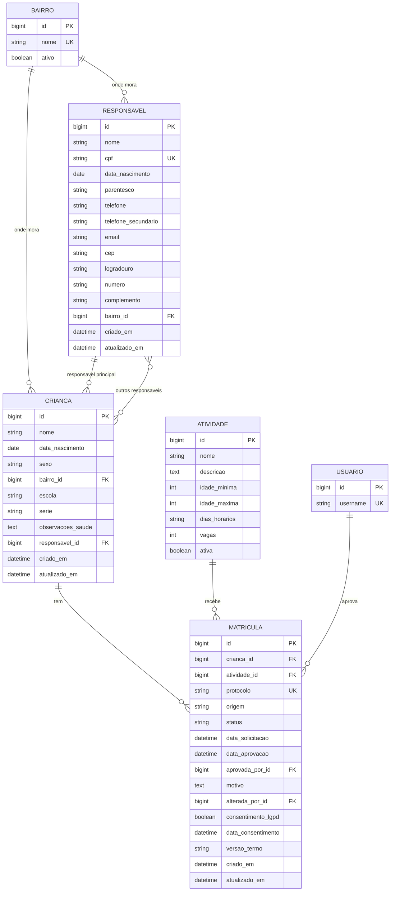
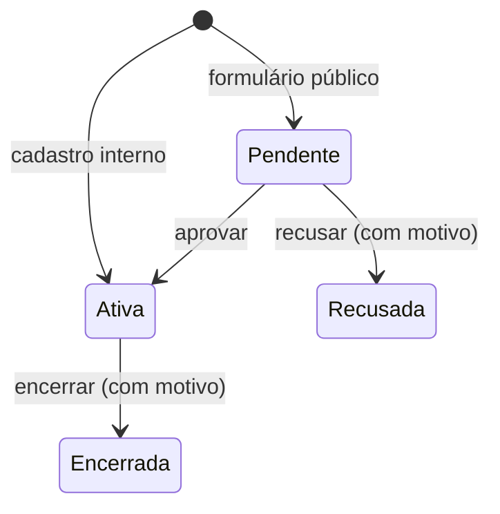

# Modelagem de dados

O banco tem cinco entidades principais, mais o usuário do próprio Django (equipe da ONG).

## Diagrama entidade-relacionamento

## Entidades

| Entidade | Arquivo | Para que serve |
| --- | --- | --- |
| Bairro | `apps/cadastros/models.py` | Lista fixa de bairros usada nos cadastros e relatórios |
| Responsável | `apps/cadastros/models.py` | Pai, mãe ou responsável legal. Tem uma ou mais crianças |
| Criança | `apps/cadastros/models.py` | Criança ou adolescente atendido. Pertence a um responsável principal e pode ter outros |
| Atividade | `apps/matriculas/models.py` | Atividade ou turma, com faixa de idade, horários e vagas |
| Matrícula | `apps/matriculas/models.py` | Liga a criança à atividade e guarda situação, protocolo, aprovação e consentimento |

## Regras importantes

**Data de nascimento, nunca a idade.** A idade e a faixa etária são calculadas na hora (propriedades `idade` e `faixa_etaria` da criança). Assim os relatórios não ficam desatualizados quando alguém faz aniversário.

**Faixas etárias em um só lugar.** A lista `FAIXAS_ETARIAS` fica em `config/settings/base.py`. Para mudar as faixas, basta alterar essa lista; filtros, painel e exportações acompanham.

**Lista fixa de bairros.** O bairro é escolhido em uma lista, e não digitado. Assim "Jd. Mirna" e "Jardim Mirna" não viram dois bairros nos relatórios.

**CPF, telefone e CEP só com números.** A máscara aparece na tela, mas o banco guarda apenas os dígitos. O CPF do responsável é único.

**Situações da matrícula.**

**Sem matrícula duplicada.** Uma criança não pode ter duas matrículas pendentes ou ativas na mesma atividade. Depois de encerrada ou recusada, pode haver uma nova.

**Protocolo.** Gerado na primeira gravação, no formato `SEM-ANO-NÚMERO` (ex.: `SEM-2026-000123`).

**Exclusões.** Excluir uma criança exclui também as matrículas dela. Um responsável só pode ser excluído se não for o responsável principal de nenhuma criança. Bairros e atividades em uso não podem ser excluídos (podem ser marcados como inativos).

## Como ajustar os campos quando a ficha da ONG chegar

1. Acrescente, altere ou remova o campo no model (`apps/cadastros/models.py` ou `apps/matriculas/models.py`).
2. Ajuste a lista `fields` do formulário correspondente em `forms.py`. O formulário público e o cadastro interno usam a mesma base, então o campo aparece nos dois.
3. Rode `python manage.py makemigrations` e `python manage.py migrate`.
4. Se o campo deve aparecer nas telas de detalhe ou na planilha, inclua no template ou em `apps/relatorios/servicos.py`.
5. Rode `pytest`.
